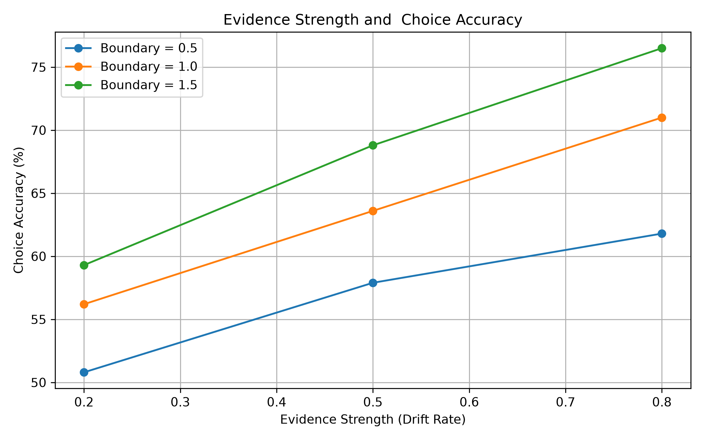
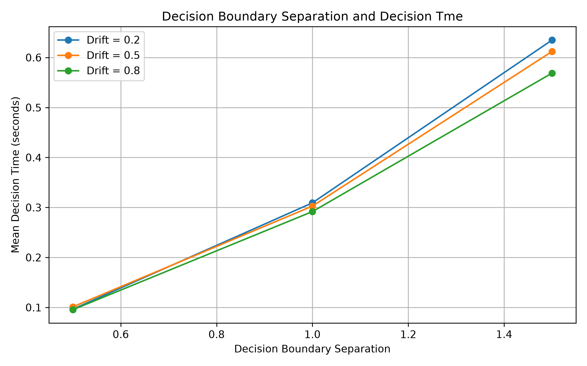

# Drift Diffusion Model (DDM) Research

**Simulating Evidence Accumulation in Human Decision-Making: A Python Implementation and Evaluation of the Drift Diffusion Model**

An independent computational research project that implements a simplified Drift Diffusion Model in Python and investigates how evidence strength and decision-boundary settings affect simulated decision accuracy and decision time.

## About the Project

The Drift Diffusion Model describes how a decision between two alternatives can emerge from the gradual accumulation of noisy evidence over time. The drift rate is the average strength and direction of the evidence. The boundary setting controls how much accumulated evidence is needed before a decision is made. Together they give a framework for studying the speed-accuracy trade-off.

## Project Objectives

- Understand the theoretical foundations of the Drift Diffusion Model.
- Implement a simplified DDM simulation in Python.
- Investigate how drift rate and boundary setting affect choice accuracy and decision time.
- Visualise the results and critically evaluate the method's limitations.

## Method

- 3 drift rates (0.2, 0.5, 0.8) x 3 boundary settings (0.5, 1.0, 1.5) = 9 conditions
- 1,000 trials per condition, 9,000 simulated trials in total
- In each trial a decision variable accumulates drift plus random noise until it reaches the upper or lower boundary
- Choices, decision times, accuracy and mean decision time were recorded for each condition
- Fixed random seed (42) for reproducibility

## Key Findings

1. **Accuracy increased with drift rate** across all boundary settings.
2. **Higher boundary settings gave higher accuracy.**
3. **Mean decision time increased with the boundary setting.**
4. The highest accuracy was **76.5%**, at drift rate 0.8 and boundary 1.5.
5. The longest mean decision time was **0.6349 seconds**, at drift rate 0.2 and boundary 1.5.
6. All 9,000 trials reached a decision boundary within the maximum simulation time.

Together, these results show a pattern consistent with the **speed-accuracy trade-off**: higher boundaries gave greater accuracy but longer decision times.

## Results








The full analysis is in the [research report](DDM_Research_Report.pdf).

## Limitations

- A simplified DDM implementation, with no human participants or real behavioural data.
- Option A was classed as correct and Option B as incorrect, with no independent ground truth.
- The starting position was set to half of the upper boundary, so changing the boundary also changed the start point. The independent effect of boundary separation was not fully isolated.
- Only three values were tested for each parameter, and only mean decision time was examined, not full response-time distributions.

## Future Work

- Vary the starting position independently of the boundary.
- Test a wider range of parameter values.
- Examine decision-time distributions.
- Compare the simulation with empirical data from decision-making experiments.

## Repository Contents

- `DDM_Research_Report.pdf`: theoretical background, methodology, results and discussion
- `ddm_simulation.py`: the DDM simulation
- `ddm_graphs.py`: generates the graphs from the simulation results
- `ddm_results.csv`: summary results for each condition
- `ddm_trial_results.csv`: data from individual trials
- `accuracy_by_drift.png`, `decision_time_by_boundary.png`: result graphs

## Technologies

Python, NumPy, Matplotlib

## Run the Project

```
pip install numpy matplotlib
python ddm_simulation.py
python ddm_graphs.py
```

## Acknowledgements

This project was informed by scientific literature on the Drift Diffusion Model and decision-making. Sources are acknowledged in the research report.
